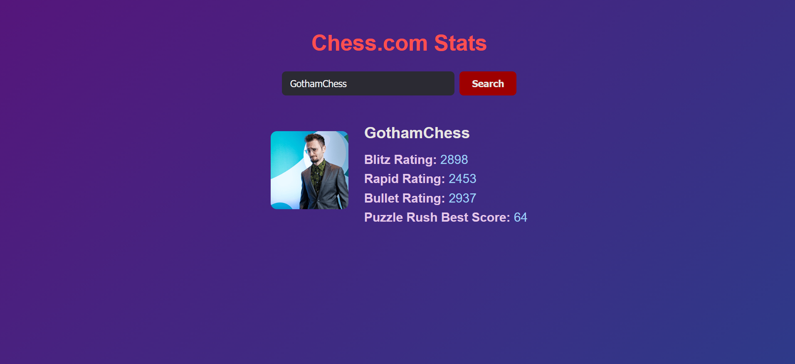

# Docker Chess Stats

A full-stack app that shows live Chess.com player stats, built with a Flask backend and a React frontend. Each part runs in its own Docker container, and Docker Compose starts them together with one command.



## How it works

```
Browser ──► Frontend (React + Nginx, port 3000)
                │
                ▼
            Backend (Flask, port 5000) ──► Chess.com public API
```

- **Backend** (`backend/`): a Flask API. `GET /chess/<username>` fetches a player's stats from the Chess.com API and returns them as JSON. CORS is enabled so the frontend can call it.
- **Frontend** (`frontend/`): a React app that shows Blitz rating, Rapid rating and Puzzle Rush best score. It is built in a Node container, then served by Nginx.
- **Docker Compose** (`docker-compose.yml`): builds both images and runs them on a shared network.

## Tech used

Python, Flask, React, JavaScript, CSS, Nginx, Docker, Docker Compose, Chess.com API

## Run it yourself

You only need [Docker Desktop](https://www.docker.com/products/docker-desktop/).

```
git clone https://github.com/ArchieMaruk/Docker-Chess_Stats.git
cd Docker-Chess_Stats
docker compose up --build
```

Then open:

- **http://localhost:3000** for the website
- **http://localhost:5000/chess/daddy_gremlin** for the raw JSON from the backend

## Stopping and restarting

**To stop the app**, press `Ctrl + C` in the terminal where it is running, then run:

```
docker compose down
```

This stops and removes both containers. Your code and the built images stay on your machine.

**To close Docker Desktop**, right-click the Docker whale icon in the system tray and choose **Quit Docker Desktop**. Closing the window with the X only hides it, and Docker keeps running in the background.

**To start it again**, open Docker Desktop, wait for "Engine running", then run this in the project folder:

```
docker compose up
```

Add `--build` only when you have changed the code and need the images rebuilt.

## Project structure

```
Docker-Chess_Stats/
├── backend/
│   ├── app.py            # Flask API
│   ├── dockerfile
│   └── requirements.txt
├── frontend/
│   ├── src/              # React components and CSS
│   ├── public/
│   ├── Dockerfile        # Node build stage + Nginx stage
│   └── nginx.conf
├── Assets/               # Screenshots
└── docker-compose.yml
```

## Note on the commit history

The frontend was originally its own nested Git repository, so only a link to it was pushed and its code was missing from GitHub. In October 2026 I recovered the original React source from my local copy and added it here.
